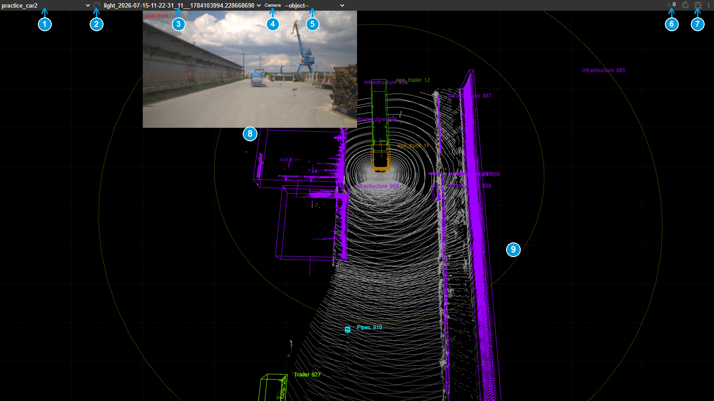
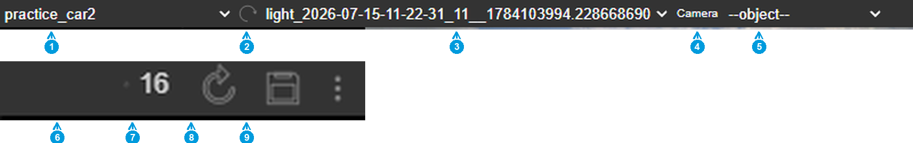
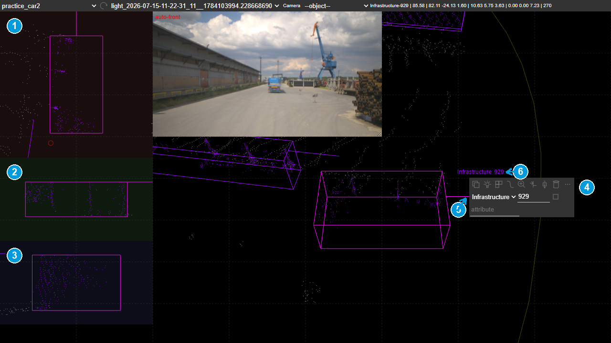
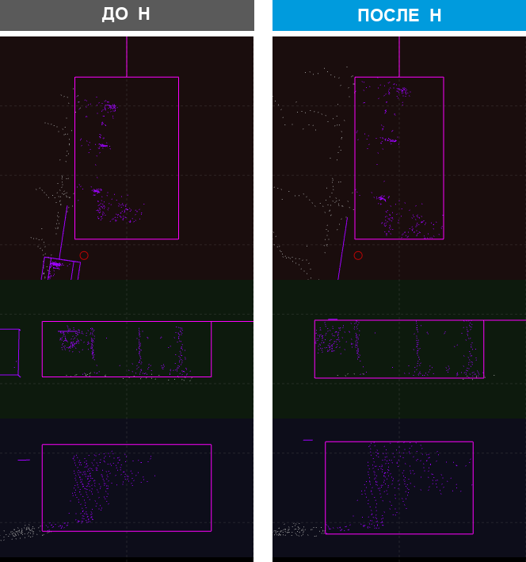
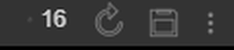
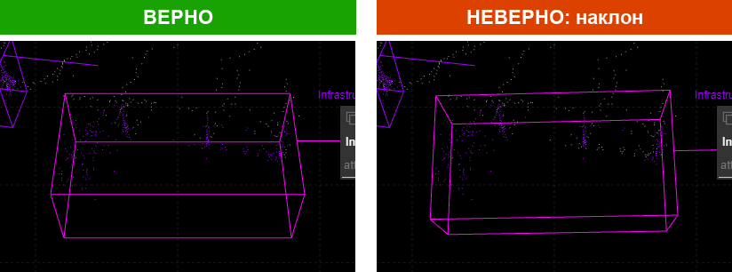
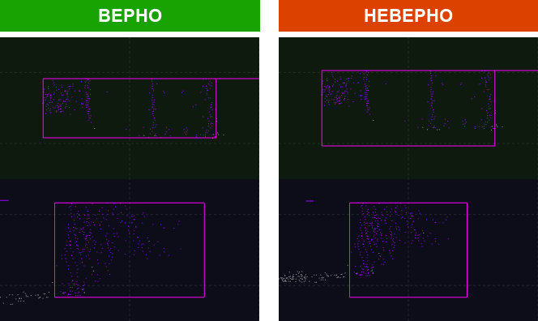
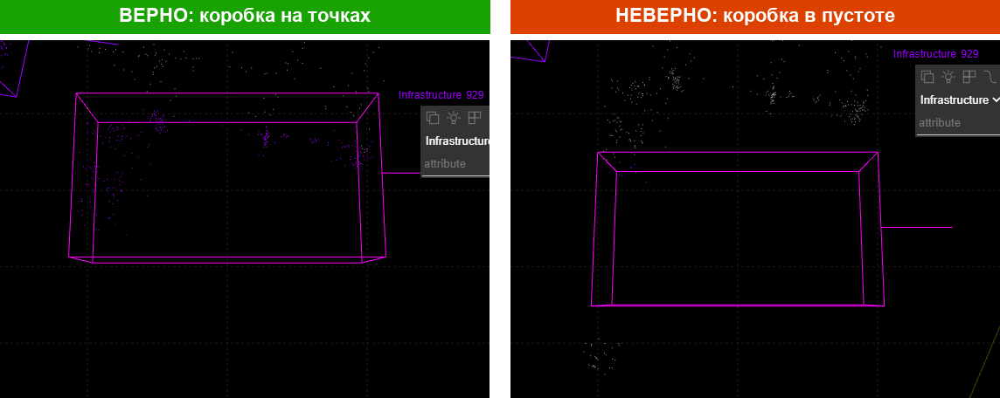

# SUSTechPOINTS для лаборатории: гайд по разметке

Инструмент 3D-разметки облаков точек с лидара, настроенный под задачи лаборатории: наборы 2–4 технического задания (классы **Infrastructure**, **Pipes**, **Dust**). Основан на открытом проекте [SUSTechPOINTS](https://github.com/naurril/SUSTechPOINTS), все изменения перечислены в [CHANGES.md](CHANGES.md). Гайд авторов по исходной программе: [doc/README_upstream.md](doc/README_upstream.md).

Этот же гайд в PDF: [doc/guide_ru.pdf](doc/guide_ru.pdf).

**Содержание**

1. [Установка и запуск](#1-установка-и-запуск)
2. [Экран программы](#2-экран-программы)
3. [Коробка: создать, выбрать, поправить](#3-коробка-создать-выбрать-поправить)
4. [Что размечаем: классы и правила](#4-что-размечаем-классы-и-правила)
5. [Порядок работы по серии кадров](#5-порядок-работы-по-серии-кадров)
6. [Типовые ошибки](#6-типовые-ошибки)
7. [Сдача разметки](#7-сдача-разметки)
8. [Горячие клавиши](#8-горячие-клавиши)
9. [Если что-то не так](#9-если-что-то-не-так)
10. [Для разработчиков](#10-для-разработчиков)

---

## 1. Установка и запуск

Программа работает на Windows. Это сервер на Python и интерфейс в браузере, поэтому после запуска открывается вкладка браузера с адресом `127.0.0.1:8081`.

### Где взять файлы

Все архивы лежат на странице релизов этого репозитория, регистрация на GitHub не нужна:
https://github.com/zamena1985/SUSTechPOINTS-lab14/releases

1. Откройте ссылку. Сверху будет последняя версия.
2. Внизу её описания раскройте список **Assets** и нажмите на нужный файл: начнётся загрузка. Какой файл нужен, написано ниже в вариантах А и Б.

Не используйте кнопку **Code → Download ZIP** на главной странице репозитория: это исходный код без Python и без пакетов, он не запустится.

### Вариант А. Портативная версия

Подходит, если программа ставится впервые.

1. Скачайте архив `SUSTechPOINTS-portable.zip` из раздела **Releases** этого репозитория.
2. Распакуйте в любую папку, например `D:\SUSTechPOINTS`. Внутри уже есть Python и все пакеты, ничего устанавливать не нужно. Архив около 110 МБ.
3. Запустите `start.bat`. Откроется чёрное окно сервера и вкладка браузера с программой.
4. При первом запуске Windows может спросить «Запустить этот файл?». Нажмите **Выполнить**. Затем брандмауэр Windows спросит разрешение для `python.exe`: нажмите **Разрешить доступ**. Это встроенный Python из папки программы, он открывает порт для браузера; в систему ничего не устанавливается.

Чтобы выключить программу, закройте чёрное окно. Чтобы удалить, удалите папку.

В портативной версии нет нейросети авто-поворота: поворот новой коробки программа считает по точкам, для инфраструктуры этого достаточно. Если нейросеть понадобится, например для разметки техники, её можно добавить в любой момент, см. ниже.

### Нейросеть авто-поворота, по желанию

Два способа, результат одинаковый. После любого из них при запуске в чёрном окне появится строка «нейросеть загружена».

- Запустите `install_tensorflow.bat` в папке программы. Он скачает TensorFlow, около 500 МБ, внутрь папки программы. Нужен интернет.
- Или скачайте `SUSTechPOINTS-tensorflow.zip` из раздела **Releases** и распакуйте поверх папки `SUSTechPOINTS`. Подходит, когда интернет слабый: архив можно передать на флешке.

Нейросеть требует процессор с инструкциями AVX, то есть ноутбук не старше примерно 2012 года.

### Вариант Б. Обновление уже установленной программы

Подходит для любой установленной копии: портативной или поставленной раньше по инструкции куратора. Разметка в папке `data` не затрагивается.

1. Закройте программу, если она запущена.
2. Запустите `update.bat` в папке программы. Он сам скачает свежий пакет с GitHub, заменит файлы и напишет «Готово».
3. Запустите программу как обычно и один раз нажмите в браузере **Ctrl+F5**, иначе браузер покажет старый интерфейс из своего кеша.

Если в папке программы ещё нет `update.bat` или интернета нет: скачайте со страницы релизов файл `update.bat` или архив `SUSTechPOINTS-update.zip` и положите в любую папку, хоть в «Загрузки». Запустите `update.bat`: он найдёт программу на рабочем столе, в «Загрузках», «Документах» или в корне диска, а если не найдёт, попросит перетащить её папку в окно. Архив рядом с ним он использует вместо скачивания. Если архив распакован, в нём только `update.bat` и папка `files`: запускать нужно `update.bat`, сама программа в этой папке не лежит.

### Вариант В. Из исходников

Для тех, кто будет менять код. Нужен Python **3.10**, именно эта версия: с другими не работает нейросеть авто-поворота.

```bat
git clone <адрес этого репозитория>
cd SUSTechPOINTS
py -3.10 -m venv venv
venv\Scripts\pip install -r requirement.txt
run.bat
```

### Данные

Сцены лежат в папке `data`, по одной папке на сцену:

```
data\<имя сцены>\
    lidar\      облака точек, по файлу на кадр
    label\      разметка, по json-файлу на кадр (создаётся программой)
    camera\     снимки камер
    calib\      калибровка камер
```

Сцену для работы выдаёт куратор. Скопируйте её папку в `data` и нажмите кнопку обновления списка сцен в шапке программы или **F5**.

---

## 2. Экран программы



1. Список сцен.
2. Обновить список сцен и кадров.
3. Список кадров сцены.
4. Выбор камеры.
5. Список объектов кадра.
6. Отмена и повтор, рядом счётчик шагов.
7. Сохранить.
8. Снимок с камеры. Помогает понять, что за объект перед вами. Разметка делается по точкам, не по снимку.
9. Облако точек и коробки. Цвет коробки зависит от класса.



Шапка слева: 1 сцена, 2 обновить, 3 кадр, 4 камера, 5 объект. Справа: 6 отменить со счётчиком, 7 повторить, 8 сохранить, 9 меню.

**Камера в главном окне.** Левая кнопка мыши вращает, правая сдвигает, колесо приближает к точке под курсором. Клавиши **3** и **4** переключают кадры назад и вперёд, **1** и **2** переключают выбранный объект, **+** и **-** меняют размер точек.

При запуске открывается окно журнала **Output**. Его можно закрыть, снова открыть можно кнопкой в шапке.

---

## 3. Коробка: создать, выбрать, поправить

### Создать

Зажмите **Ctrl** и левой кнопкой мыши обведите прямоугольником точки объекта. Удобнее всего делать это на виде сверху. Коробка появляется сразу, с классом **Infrastructure**. Поворот программа подбирает сама по точкам внутри выделения: коробка ложится вдоль длинной стороны объекта. Если установлена нейросеть, поворот подбирает она. В обоих случаях проверьте результат и при необходимости поправьте поворот руками, как описано ниже.

Если коробка не появилась, повторите выделение. Если точек внутри слишком мало, программа коробку не создаст.

### Выбрать

Щелчок левой кнопкой по коробке выделяет её. Открывается меню объекта и три окошка слева.



1. Вид сверху.
2. Вид сбоку.
3. Вид спереди.
4. Меню объекта: класс, номер (ID), атрибут и кнопки действий. Атрибут для инфраструктуры не заполняется.
5. Линия направления. Для инфраструктуры важно только, чтобы стороны коробки шли вдоль объекта. Куда смотрит линия, значения не имеет. Для техники линия должна смотреть туда, куда смотрит кабина.
6. Подпись: класс и номер.

Повторный щелчок по выделенной коробке показывает стрелки перемещения. Правая кнопка открывает контекстное меню. **Esc** снимает выделение.

### Группа: несколько коробок сразу

Нужно, когда одинаковый набор объектов повторяется, например стеллаж из нескольких секций или ряд труб.

1. **Shift+ЛКМ** по коробке добавляет её в группу, повторный Shift+щелчок убирает. Коробки группы белые, в шапке появляется счётчик «группа: N».
2. **J** дублирует группу: копии с теми же размерами, классами и расстояниями между собой появляются чуть правее и сами становятся группой. Остаётся подвинуть их на место: **W S A D** двигают всю группу, **Q** / **E** поворачивают её вокруг общего центра.
3. **Delete** удаляет все коробки группы, **Esc** или обычный щелчок снимает группу. Любое действие с группой отменяется одним **Ctrl+Z**.

Без группы **J** дублирует выбранную коробку. Новые коробки получают новые номера, копировать объект под старым номером нельзя.

### Поправить в окошках

В каждом окошке коробка показана в своих осях, поэтому стороны всегда горизонтальны и вертикальны.

- Потяните за сторону, чтобы изменить размер.
- Двойной щелчок по стороне подтягивает её к ближайшей точке. Проверяйте результат: ближайшая точка может принадлежать соседнему объекту.
- Двойной щелчок по центру подтягивает все стороны сразу.
- Потяните за линию направления, чтобы повернуть коробку. Двойной щелчок по линии разворачивает направление на 180°.
- Правая кнопка сдвигает вид в окошке, двойной щелчок правой кнопкой возвращает его к центру. Колесо приближает.

### Поправить клавишами

Клавиши работают, когда курсор над главным окном или над окошками, и в любой раскладке клавиатуры.

| Клавиши | Действие |
|---|---|
| **W S A D** | Сдвинуть коробку вперёд, назад, влево, вправо |
| **Q E** | Повернуть на шаг |
| **R F** | Повернуть на шаг и сразу подтянуть стороны к точкам |
| **G** | Развернуть направление на 180° |
| **H** | Подогнать коробку инфраструктуры по точкам, см. ниже |
| **Delete** | Удалить коробку |
| **Ctrl+Z**, **Ctrl+Y** | Отменить, повторить |

### Клавиша H: подгонка инфраструктуры

Обведите объект грубо, выделите коробку и нажмите **H**. Коробка стягивается к точкам внутри неё, низ встаёт на землю, верх по самой высокой точке, наклон убирается. Поворот не меняется, его задаёте вы клавишами **Q** и **E**.



Правило: **H** никогда не делает коробку больше, чем вы нарисовали, и не трогает стороны длиннее 15 метров. Поэтому обводите объект **чуть плотнее**, чем кажется нужным: лишнее внутри уйдёт, а захваченного соседа клавиша не отрежет. Результат пишется в журнал: `стянуто по 5466 точкам: 1.8 x 11.4 x 4.0 м, низ на земле`.

### Отмена

**Ctrl+Z** отменяет последнее действие, **Ctrl+Y** возвращает. Запоминается до 50 шагов на кадр: сдвиг, поворот, размер, класс, добавление, удаление, подгонка. Движение мышью в окошке считается одним шагом. Счётчик в шапке показывает, сколько шагов можно отменить.



### Сохранение

Программа сохраняет кадр сама через пару секунд после изменения. Перед запуском инструментов из раздела 5 и перед закрытием нажмите **Ctrl+S**, чтобы быть уверенным.

---

## 4. Что размечаем: классы и правила

Техническое задание делит работу на четыре набора. Наш объём: наборы 2, 3 и 4.

| Класс | Что входит |
|---|---|
| **Infrastructure** | Крупные объекты и конструкции: ангары, здания, стены, заборы, стеллажи, крупные металлоконструкции, штабели и складированные материалы. Всё, что может быть препятствием для движения. |
| **Pipes** | Узкие вытянутые объекты: трубы, столбы, стойки, вешки, знаки. |
| **Dust** | Снежная взвесь или дым, только если они образуют отчётливую плотную область в точках. Снег и дождь не размечаются. |

Техника из набора 1 (`Truck`, `Trailer`, `Car`, `Pedestrian`, `ego_truck`, `ego_trailer`) в выданных кадрах уже размечена куратором. Её не трогаем, кроме явных ошибок.

**Правила постановки коробки** из технического задания:

- Коробка охватывает объект целиком по длине, ширине и высоте и при этом плотно: без большого запаса, без захвата пустоты, дороги и соседей.
- Объекты разных классов никогда не объединяются в одну коробку. Стойка рядом со стеной: отдельно `Pipes`, отдельно `Infrastructure`.
- Независимые объекты с заметным зазором размечаются отдельно. Единая куча или компактная конструкция может быть одной коробкой.
- Длинная конструкция, стена или забор, делится на секции, если один общий бокс выходит чрезмерно длинным или содержит большие пустые промежутки.
- Если объект виден частично, коробка ставится по видимой части. Достраивать невидимое не нужно.
- Размечаются только значимые объекты. Неровности поверхности, колеи, малые насыпи не размечаются.
- Объект размечается, только если по точкам можно уверенно понять, что это. Несколько точек без формы не размечаются.
- В последовательности кадров один и тот же объект сохраняет размеры, положение, класс и **номер**. Номера нужны для трекинга, поэтому у каждой коробки должен быть номер и он не должен повторяться в кадре.

---

## 5. Порядок работы по серии кадров

Кадры идут сериями по три: машина стоит почти на месте, инфраструктура вокруг одна и та же. Поэтому вручную размечается **первый кадр серии**, а в остальные два коробки переносятся инструментом.

1. **Первый кадр серии.** Обведите все объекты наборов 2–4 (`Ctrl+ЛКМ`), по каждой коробке нажмите **H**, при необходимости поправьте поворот **Q** и **E**, проверьте класс. Сохраните: **Ctrl+S**.
2. **Перенос в соседние кадры.** Запустите `transfer.bat`, указав кадры серии и образец:

   ```bat
   transfer.bat --frames 76-78 --ref 76
   ```

   Инструмент совмещает облака точек соседних кадров, находит сдвиг машины и переставляет коробки. После переноса обновите страницу в браузере: **F5**.
3. **Проверка переноса.** Пройдите второй и третий кадр: коробки должны лечь на точки. Где сдвинулось, поправьте клавишами или нажмите **H**.
4. **Автоматическая проверка.** Запустите `check.bat` на свою серию:

   ```bat
   check.bat --frames 76-78
   ```

   Отчёт делится на **ОШИБКА**, что обязательно исправить, и **проверить**, на что стоит взглянуть. Список сообщений в разделе 6. Исправьте, сохраните, запустите снова, пока ошибок не останется.
5. Переходите к следующей серии.

Черновик для первого кадра можно получить автоматически: инструмент находит скопления точек выше земли без коробок и обводит их. Каждую коробку черновика нужно проверить глазами, лишние удалить, класс поправить.

```bat
venv\Scripts\python tools\infra_draft.py --frames 76
```

Все три инструмента по умолчанию работают со сценой `data\car2_15july_SUS_angle_64-83`. Для другой сцены добавьте `--scene data\<имя сцены>`.

---

## 6. Типовые ошибки

Что пишет проверка и что делать.

| Сообщение | Что это значит | Что делать |
|---|---|---|
| `коробка без ID` | У коробки нет номера | Нажмите кнопку генерации номера в меню объекта или введите номер |
| `ID … повторяется в кадре` | Два объекта с одним номером | Дайте одному из них новый номер |
| `коробка стоит в пустоте` | Внутри почти нет точек | Сдвиньте коробку на объект или удалите |
| `низ коробки … ниже земли` | Коробка захватила дорогу | Нажмите **H** или поднимите низ в окошке сбоку |
| `коробка наклонена` | Коробка завалена вокруг горизонтальной оси | Нажмите **H**, наклон обнулится |
| `… а в кадре #N … м` | Размер отличается от соседнего кадра | Сравните кадры, сделайте одинаково |
| `пустота … можно поджать сторону` | Между стороной и точками большой зазор | Подтяните сторону или нажмите **H** |
| `высота … пропущенный объект?` | Рядом высокое скопление точек без коробки | Посмотрите, не пропущен ли объект |
| `недопустимый класс` | Класса нет в списке задания | Выберите класс из списка |

Три ошибки, которые встречаются чаще всего.



Коробка завалена. Снаружи это видно по непараллельным рёбрам, проверка пишет `коробка наклонена`. Лечится клавишей **H**.



Слева низ коробки стоит на земле. Справа коробка захватила слой дороги, точки земли оказались внутри. Лечится клавишей **H**.



Коробка не на объекте. Так бывает после переноса между кадрами, если машина сдвинулась сильнее обычного. Сдвиньте коробку на точки или удалите.

Четвёртая частая ошибка: **два объекта в одной коробке**. Если внутри коробки видны два скопления точек с просветом между ними, разделите на две коробки. Проверка подскажет большую пустоту внутри.

---

## 7. Сдача разметки

Разметка кадра лежит в `data\<имя сцены>\label\<имя кадра>.json`. Для сдачи:

1. Сохраните всё: **Ctrl+S** в каждом изменённом кадре.
2. Запустите `check.bat` на сданные кадры и убедитесь, что ошибок нет.
3. Упакуйте папку `label` в архив и загрузите в облачную папку, которую выдал куратор. В сообщении укажите номера кадров.

Кадры, которые куратор уже принял, повторно не правятся и не отправляются.

---

## 8. Горячие клавиши

| Клавиши | Действие |
|---|---|
| **ЛКМ** / **ПКМ** / колесо | Вращать / сдвигать / приближать камеру |
| **Ctrl+ЛКМ** | Новая коробка по выделенной области |
| **ЛКМ** по коробке | Выбрать коробку |
| **Esc** | Снять выделение |
| **Shift+ЛКМ** по коробке | Добавить в группу / убрать из группы |
| **1** / **2** | Предыдущий / следующий объект |
| **3** / **4**, **PageUp** / **PageDown** | Предыдущий / следующий кадр |
| **+** / **-** | Размер точек |
| **W S A D** | Сдвинуть коробку (или всю группу) |
| **Q** / **E** | Повернуть коробку (или группу вокруг её центра) |
| **R** / **F** | Повернуть и подтянуть стороны к точкам |
| **G** | Развернуть направление на 180° |
| **H** | Подогнать коробку инфраструктуры по точкам |
| **J** | Дублировать группу (или выбранную коробку) |
| **Delete**, **Ctrl+D** | Удалить коробку (Delete при группе: все коробки группы) |
| **Ctrl+Z** / **Ctrl+Y** | Отменить / повторить |
| **Ctrl+S** | Сохранить |
| **V** | Режим правки объекта сразу в нескольких кадрах (для техники) |
| В окошке: **ПКМ** | Сдвинуть вид; двойной щелчок **ПКМ** вернуть к центру |
| В окошке: двойной щелчок по стороне / центру | Подтянуть сторону / все стороны к точкам |
| В окошке: двойной щелчок по линии направления | Развернуть направление |

---

## 9. Если что-то не так

**Экран стал белым или пропало 3D.** Браузеру не хватило памяти. Обновите страницу: **F5**. Разметка не теряется, она сохраняется на диск.

**После обновления программы интерфейс выглядит по-старому.** Браузер показывает старые файлы из кеша. Нажмите **Ctrl+F5** один раз.

**Страница не открывается или сервер сразу закрывается.** Уже запущена другая копия программы, обе хотят порт 8081. Закройте лишнее чёрное окно и запустите снова.

**Клавиши не действуют.** Щёлкните по сцене, чтобы фокус был в программе, а не в адресной строке или поле ввода. Раскладка клавиатуры значения не имеет.

**Коробка не появилась после Ctrl+ЛКМ.** Повторите выделение. Если точек слишком мало, коробка не создаётся.

**Коробка создалась с неверным поворотом.** Так бывает, если в выделение попал сосед или много земли, а с нейросетью ещё и потому, что она обучена на машинах. Поверните клавишами **Q** и **E** или потяните за линию направления в окошке.

**Портативная версия при запуске пишет об отсутствии DLL** (`msvcp140`, `vcruntime140`). Не хватает системной библиотеки Microsoft. Установите «Visual C++ Redistributable 2015–2022 x64» с сайта Microsoft и запустите снова.

**При запуске из исходников ошибка про tensorflow.** Проверьте версию Python: нужна 3.10. Окружение должно создаваться командой `py -3.10 -m venv venv`.

**Брандмауэр спрашивает разрешение для python.exe.** Это сервер программы из папки `python` внутри неё. Нажмите «Разрешить доступ», вопрос больше не повторится. Если нажать «Отмена», браузер не сможет открыть программу.

**Windows спрашивает «Запустить этот файл?».** Это обычный вопрос для скачанных bat-файлов. Нажмите **Выполнить**.

---

## 10. Для разработчиков

- `public/js/` — интерфейс. После правки любого файла здесь запустите `bump_version.bat`, иначе браузер возьмёт старые скрипты из кеша. Затем **F5**.
- `tools/infra_transfer.py`, `tools/infra_check.py`, `tools/infra_draft.py` — инструменты разметки, параметры смотрите через `--help`.
- `public/js/obj_cfg.js` — список классов и их цвета.
- `server.conf` — порт и каталоги сервера.
- `algos/pre_annotate.py` — авто-поворот: нейросеть, если TensorFlow установлен, иначе геометрия точек. Переменная окружения `SUSTECH_NO_TF=1` отключает нейросеть принудительно.
- `tools/make_update.py`, `tools/make_portable.py` (`--full`), `tools/make_tf_addon.py` — сборка архивов для релиза в `dist/`.
- `CHANGES.md` — журнал всех изменений относительно оригинала. Дополняйте его при каждой правке: этого требует лицензия GPL-3.0.
- `tools/build_guide.py` — собирает этот гайд в PDF: `venv\Scripts\python tools\build_guide.py`.

Проект распространяется по лицензии GPL-3.0, как и оригинал.
